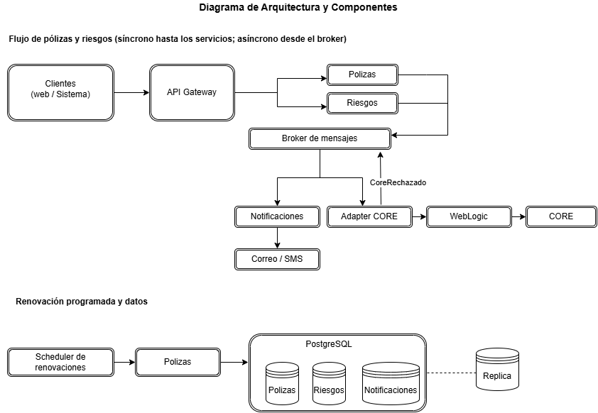

# Pólizas API

API REST para gestionar pólizas de arrendamiento (individuales y colectivas) y sus riesgos.
Es la implementación esencial del **Servicio de Pólizas** de la arquitectura propuesta en el Módulo 1.

## Contenido del repositorio

| Módulo | Entregable |
|---|---|
| Módulo 1: arquitectura | [`docs/Fabian_Rodriguez_Prueba_Tecnica_Modulo1.pdf`](docs/Fabian_Rodriguez_Prueba_Tecnica_Modulo1.pdf): arquitectura de alto nivel, patrones, modelo de datos, manejo de conceptos y diagrama de componentes |
| Módulo 2: implementación | Este proyecto Spring Boot, la colección de Postman y este README |



El modelo de datos completo está en [`docs/modelo-datos.png`](docs/modelo-datos.png).

**Tecnologías:** Java 21, Spring Boot 4.0.9, Spring Web MVC, Spring Data JPA, Bean Validation, Lombok y H2 (base de datos en memoria).

## Requisitos

- **JDK 21 o superior.** No hace falta instalar Maven ni una base de datos: el proyecto incluye Maven Wrapper y usa H2 en memoria.

## Cómo ejecutarlo

Desde la carpeta del proyecto:

```bash
# Windows
mvnw.cmd spring-boot:run

# Linux / macOS
./mvnw spring-boot:run
```

La API queda disponible en `http://localhost:8080`. Para usar otro puerto: `mvnw.cmd spring-boot:run -Dspring-boot.run.arguments=--server.port=9090`.

Al arrancar se cargan datos de ejemplo (`src/main/resources/data.sql`). Como la base es en memoria, **los datos vuelven a su estado inicial cada vez que se reinicia la aplicación**.

Para ejecutar las pruebas: `mvnw.cmd test`.

## Seguridad

Todas las peticiones deben incluir el header:

```
x-api-key: 123456
```

Sin él, o con un valor distinto, la API responde `401 Unauthorized`. El valor se configura en `security.api-key` (o con la variable de entorno `API_KEY`).

## Endpoints

| # | Método y ruta | Descripción | Respuesta exitosa |
|---|---|---|---|
| 1 | `GET /polizas?tipo=&estado=` | Lista pólizas. Los filtros son opcionales. `tipo`: `INDIVIDUAL` o `COLECTIVA`; `estado`: `VIGENTE`, `RENOVADA` o `CANCELADA` | `200` |
| 2 | `GET /polizas/{id}/riesgos` | Lista los riesgos de una póliza | `200` |
| 3 | `POST /polizas/{id}/renovar` | Incrementa canon y prima en el IPC y deja la póliza en `RENOVADA` | `200` |
| 4 | `POST /polizas/{id}/cancelar` | Cancela la póliza y todos sus riesgos activos | `200` |
| 5 | `POST /polizas/{id}/riesgos` | Agrega un riesgo. Solo para pólizas `COLECTIVA` | `201` |
| 6 | `POST /riesgos/{id}/cancelar` | Cancela un riesgo | `200` |
| — | `POST /core-mock/evento` | Mock del servicio de edición del CORE: solo registra el evento en los logs | `202` |

### Ejemplos

```bash
# 1. Pólizas colectivas vigentes
curl -H "x-api-key: 123456" "http://localhost:8080/polizas?tipo=COLECTIVA&estado=VIGENTE"

# 2. Riesgos de la póliza 2
curl -H "x-api-key: 123456" http://localhost:8080/polizas/2/riesgos

# 3. Renovar la póliza 1
curl -X POST -H "x-api-key: 123456" http://localhost:8080/polizas/1/renovar

# 4. Cancelar la póliza 3 (también cancela sus riesgos)
curl -X POST -H "x-api-key: 123456" http://localhost:8080/polizas/3/cancelar

# 5. Agregar un riesgo a la póliza colectiva 2
curl -X POST -H "x-api-key: 123456" -H "Content-Type: application/json" \
     -d '{"direccionInmueble":"Calle 50 # 20-10","arrendatario":"Pablo Ruiz","arrendador":"Camila Soto"}' \
     http://localhost:8080/polizas/2/riesgos

# 6. Cancelar el riesgo 3 (de la póliza colectiva 2)
curl -X POST -H "x-api-key: 123456" http://localhost:8080/riesgos/3/cancelar

# Mock del CORE
curl -X POST -H "x-api-key: 123456" -H "Content-Type: application/json" \
     -d '{"evento":"ACTUALIZACION","polizaId":555}' http://localhost:8080/core-mock/evento
```

### Colección de Postman

El archivo `Prueba Poliza.postman_collection.json` trae los 22 requests (casos de éxito y de error), con el header `x-api-key` configurado en la colección y pruebas automáticas del código de respuesta. Para usarla: en Postman, *Import* y seleccionar el archivo. Las variables `baseUrl` y `apiKey` se ajustan en la pestaña *Variables* de la colección.

Los requests están ordenados para ejecutarse en secuencia con el *Collection Runner* sobre los datos de ejemplo: reiniciar la API antes de volver a ejecutarlos.

Cuerpo para agregar un riesgo (todos los campos son obligatorios):

```json
{
  "direccionInmueble": "Calle 50 # 20-10, Medellín",
  "arrendatario": "Pablo Ruiz",
  "arrendador": "Camila Soto"
}
```

## Datos de ejemplo

| Id | Número | Tipo | Estado | Riesgos (id) | Útil para probar |
|---|---|---|---|---|---|
| 1 | POL-0001 | INDIVIDUAL | VIGENTE | 1 | Renovar; rechazo al agregar riesgo a una individual |
| 2 | POL-0002 | COLECTIVA | VIGENTE | 2, 3 | Agregar y cancelar riesgos |
| 3 | POL-0003 | COLECTIVA | VIGENTE | 4 | Cancelar la póliza y ver sus riesgos cancelados |
| 4 | POL-0004 | INDIVIDUAL | RENOVADA | 5 | Filtrar por estado `RENOVADA` |
| 5 | POL-0005 | COLECTIVA | CANCELADA | 6 (cancelado) | Rechazo al renovar o agregar riesgos |

## Reglas de negocio

| Regla | Comportamiento |
|---|---|
| Una póliza individual solo puede tener 1 riesgo | Agregar un riesgo a una individual se rechaza. Su único riesgo tampoco se cancela por separado: se cancela la póliza |
| No se puede renovar una póliza cancelada | `422` |
| La cancelación de una póliza cancela todos sus riesgos | Los riesgos activos pasan a `CANCELADO` con la fecha de cancelación |
| Agregar riesgo exige validar el tipo de póliza | Solo `COLECTIVA`, y que no esté cancelada |

**Renovación:** `canon nuevo = canon x (1 + IPC / 100)` y `prima = canon nuevo x meses de vigencia`, por lo que la prima también aumenta en el IPC. La vigencia se extiende por el mismo número de meses de la vigencia inicial. El IPC se configura en `polizas.ipc-porcentaje` (por defecto `5.20`).

## Errores

Todas las respuestas de error tienen el mismo formato:

```json
{
  "timestamp": "2026-11-12T13:01:14.091",
  "status": 422,
  "error": "Unprocessable Content",
  "message": "No se puede renovar la póliza 5 porque está cancelada",
  "path": "/polizas/5/renovar"
}
```

| Código | Cuándo |
|---|---|
| `400` | Datos inválidos (incluye `errors` con cada campo), JSON mal formado o parámetro con valor inválido, como `tipo=OTRO` |
| `401` | Falta el header `x-api-key` o su valor no es válido |
| `404` | La póliza, el riesgo o la ruta no existen |
| `405` | Método HTTP no permitido en la ruta |
| `422` | La operación viola una regla de negocio |
| `500` | Error inesperado (se registra en el log, sin exponer detalles al cliente) |

## Integración con el CORE

Toda acción que modifica el estado de una póliza o de un riesgo (renovar, cancelar póliza, agregar riesgo y cancelar riesgo) envía al servicio de edición del CORE el evento:

```json
{ "evento": "ACTUALIZACION", "polizaId": 2 }
```

- El envío lo hace `CoreClient` (el *Adapter CORE* de la arquitectura), que en esta prueba apunta al mock `POST /core-mock/evento`. La URL se configura en `core.url`.
- Se envía **solo después de confirmar la transacción** (`@TransactionalEventListener`, fase `AFTER_COMMIT`): si la operación falla, el CORE no recibe un cambio que no ocurrió.
- El mock registra en el log una línea como: `[CORE-MOCK] Operación enviada al CORE: evento=ACTUALIZACION, polizaId=2`.
- Si el CORE no responde, la operación local no se revierte y el error queda registrado en el log.

## Estructura del proyecto

```
src/main/java/com/prueba/polizas
├── controller/   PolizaController, RiesgoController, CoreMockController
├── service/      PolizaService, RiesgoService (interfaces) e impl/ con las reglas de negocio
├── repository/   PolizaRepository, RiesgoRepository (Spring Data JPA)
├── entity/       Poliza, Riesgo y enums/ (TipoPoliza, EstadoPoliza, EstadoRiesgo)
├── dto/          Objetos de entrada y salida de la API (records)
├── exception/    Excepciones de negocio y manejador global de errores
├── config/       ApiKeyFilter (seguridad con x-api-key)
└── client/       CoreClient, CoreEvent y CoreEventListener (integración con el CORE)
```

## Consola de H2

Para revisar los datos: `http://localhost:8080/h2-console`, con JDBC URL `jdbc:h2:mem:polizasdb`, usuario `sa` y sin contraseña. Esta ruta no exige `x-api-key`, porque es solo una herramienta de desarrollo.

## Decisiones y supuestos

- **Alcance:** se implementa solo el Servicio de Pólizas, que también gestiona los riesgos, porque los endpoints solicitados los combinan. Los demás componentes de la arquitectura (API Gateway, broker, Notificaciones y Scheduler) no forman parte de este alcance.
- **Base de datos:** H2 en memoria, para que la API se ejecute sin instalar nada. En producción se usaría PostgreSQL, como en la arquitectura propuesta; el cambio es de configuración.
- **Canon y prima a nivel de póliza:** se manejan en la póliza, como pide el enunciado de la renovación. En el modelo completo del Módulo 1, el canon vive en cada riesgo de una colectiva.
- **Renovación:** actualiza la misma póliza, tal como indica el requerimiento ("el estado pasa a RENOVADA"). Una póliza renovada puede volver a renovarse.
- **Evento genérico:** se envía siempre `ACTUALIZACION`, porque el servicio de edición del CORE es agnóstico al tipo de cambio.
- **Reintentos con el CORE:** en esta versión, si el CORE falla, el error queda en el log. En producción se reintentaría con espera creciente y una cola de errores, como se describe en el Módulo 1.
- **Seguridad:** el `x-api-key` es la seguridad mínima solicitada. En producción se usaría OAuth2/JWT en el API Gateway.
